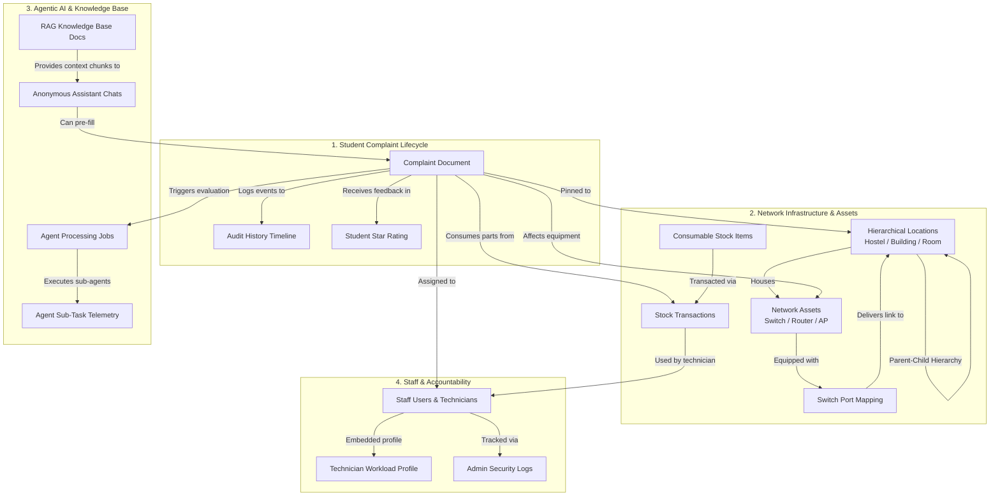
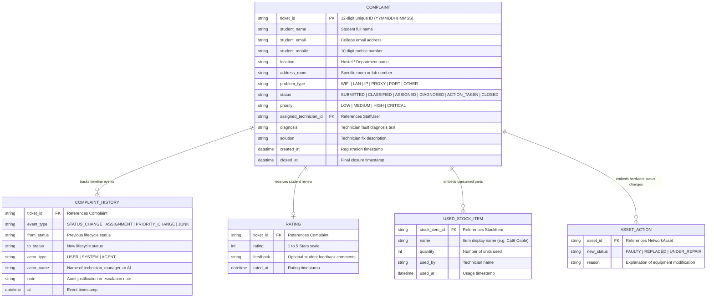
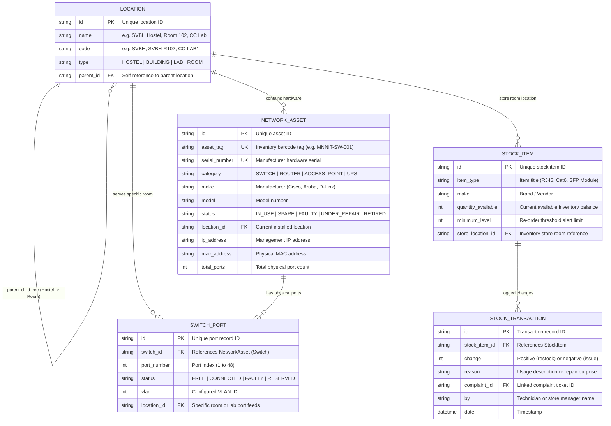
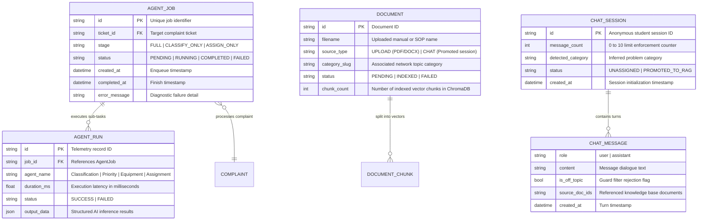
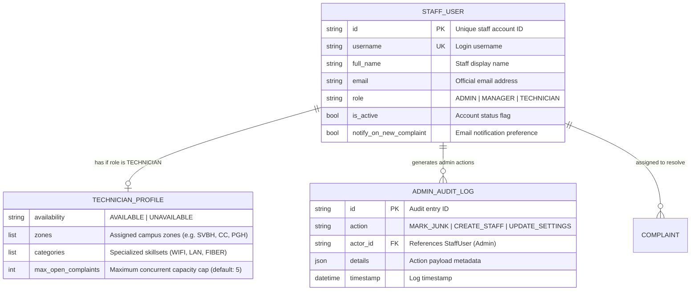

# MNNIT Network Portal - System Architecture & Data Models

This document presents the complete architectural schema design of the **MNNIT Allahabad Network Complaint Portal**. It is structured into **four core interconnected clusters**, highlighting major business entities and their relationships.

---

## 1. Master Architectural Overview

The system bridges **Students**, **Staff / Technicians**, **Physical Network Hardware**, and **Autonomous AI Agents** into an integrated workflow.

---

## 2. Cluster 1: Complaint Lifecycle & Resolution Schemas

Tracks complaints from student submission through AI triage, technician repair, stock consumption, and student rating confirmation.

### Key Business Significance:
- **Zero-Data-Loss Audit Trail**: Every status transition, priority upgrade, and technician re-assignment is immutably logged in `COMPLAINT_HISTORY`.
- **Embedded Accountability**: Parts used and hardware replaced are recorded directly inside the complaint record to guarantee billing and stock integrity.

---

## 3. Cluster 2: Network Infrastructure, Assets & Stock Schemas

Models physical campus geography (hostels, labs, floors, rooms), hardware assets (switches, routers, APs), switch port patchings, and consumable stock parts.

### Key Business Significance:
- **Hierarchical Geography**: Locations are recursive parent-child trees (`SVBH Hostel > Floor 1 > Room 102`).
- **Hardware vs. Consumable Separation**: High-value devices (`NETWORK_ASSET`) are individually serialized and repaired, whereas small parts (`STOCK_ITEM`) are tracked by inventory balance.

---

## 4. Cluster 3: AI Agentic Pipeline & Knowledge Base Schemas

Coordinates the multi-stage autonomous AI pipeline (Classification, Priority, Equipment Matching, Technician Scoring) and the RAG (Retrieval-Augmented Generation) knowledge base.

### Key Business Significance:
- **Observability**: `AGENT_RUN` tracks execution time and accuracy of every individual AI sub-agent.
- **Two-Step RAG Retrieval**: Student chat turns undergo contextual reformulation to resolve pronouns before vector similarity search against `DOCUMENT` chunks.

---

## 5. Cluster 4: Staff Roles & Technician Accountability Schemas

Governs Role-Based Access Control (RBAC), technician availability schedules, workload caps, and administrative audit logging.

### Key Business Significance:
- **Technician Burnout Guard**: `max_open_complaints` ensures no technician is assigned more active tickets than their threshold.
- **Admin Audit Trail**: High-stakes operations (marking junk tickets, password resets, setting changes) are strictly logged in `ADMIN_AUDIT_LOG`.

---

## 6. Relational Cardinality Summary Table

| Relationship | Cardinality | Business Meaning |
| :--- | :---: | :--- |
| **Location ➔ Location** | `1 : N` | Recursive campus hierarchy (`Parent Hostel` ➔ `Child Rooms`). |
| **Location ➔ NetworkAsset** | `1 : N` | A single room or rack houses multiple switches, routers, and access points. |
| **NetworkAsset ➔ SwitchPort** | `1 : N` | One physical switch contains 24 or 48 ports. |
| **SwitchPort ➔ Location** | `N : 1` | Multiple switch ports provide network links to the same hostel room or lab. |
| **Complaint ➔ ComplaintHistory** | `1 : N` | A complaint collects a timeline of status updates, reassignments, and notes. |
| **Complaint ➔ StaffUser** | `N : 1` | Many complaints are assigned to one qualified technician. |
| **Complaint ➔ StockTransaction** | `1 : N` | Resolving a complaint consumes multiple stock items (e.g. 2 patch cords, 4 connectors). |
| **StockItem ➔ StockTransaction** | `1 : N` | An inventory item logs multiple issue and restock events over time. |
| **AgentJob ➔ AgentRun** | `1 : N` | An end-to-end AI evaluation runs multiple sub-agents (Classification, Priority, Routing). |
