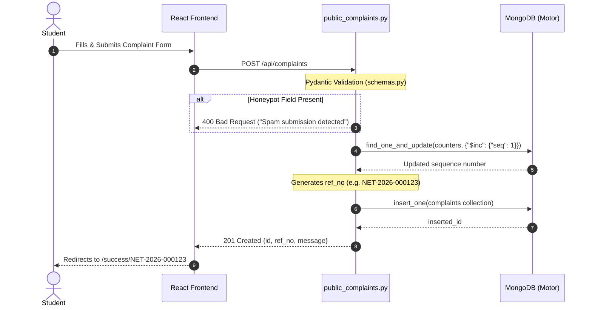
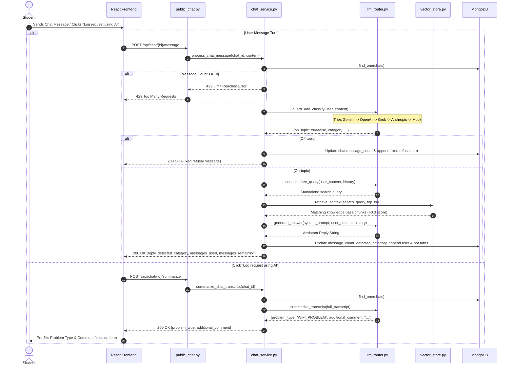
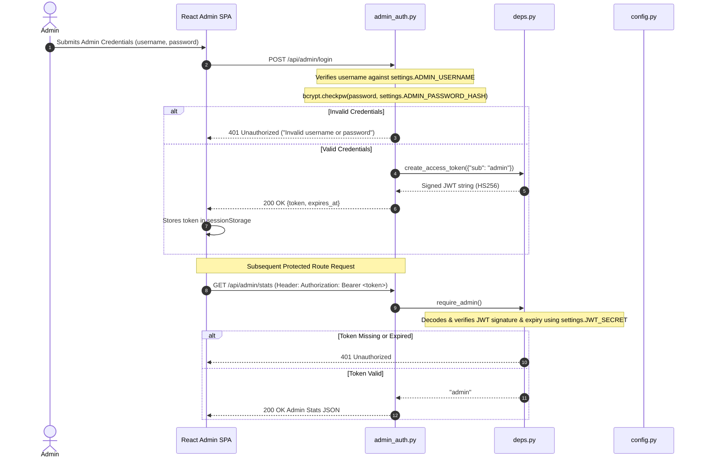

# MNNIT Network Portal — Backend Architecture & Developer Guide

This document is a comprehensive technical guide to the backend of the **MNNIT Allahabad AI-Assisted Network Complaint Portal**. It is written for developers who understand web applications and Python but are new to this repository.

---

## Table of Contents

1. [Overview](#1-overview)
2. [Folder and File Map](#2-folder-and-file-map)
3. [Request Flow Walkthroughs](#3-request-flow-walkthroughs)
   - [Complaint Submission Flow](#31-complaint-submission-flow)
   - [AI Diagnosis & Form Pre-fill Flow](#32-ai-diagnosis--form-pre-fill-flow)
   - [Admin Login & Authentication Flow](#33-admin-login--authentication-flow)
   - [Admin Chat & Document Curation Flow](#34-admin-chat--document-curation-flow)
4. [Error and Edge-Case Flows](#4-error-and-edge-case-flows)
5. [Data Model](#5-data-model)
6. [API Reference](#6-api-reference)
7. [Configuration and Running](#7-configuration-and-running)
8. [Gotchas and Observations](#8-gotchas-and-observations)

---

## 1. Overview

### Project Purpose
The **AI-Assisted Network Complaint Portal** is a web-based system designed for students at MNNIT Allahabad to report campus network faults (Wi-Fi, wired LAN, IP allocation, proxy configuration, and broken physical ports). Students can optionally converse with an AI assistant that diagnoses their problem using a knowledge base grounded in RAG (Retrieval-Augmented Generation). Once diagnosed, students can click a button to auto-fill the complaint form fields directly from the AI chat transcript. An admin portal allows network engineers to review student transcripts, promote valuable chats or upload SOP documents (.pdf, .docx, .txt) into curated reference categories, and continuously re-index the RAG database.

### Tech Stack
- **Framework**: Python 3.11+ with **FastAPI** 0.110+ (ASGI web server via **Uvicorn**).
- **Database**: **MongoDB** accessed asynchronously via the **Motor** driver (`motor.motor_asyncio`).
- **Vector Store**: **ChromaDB** (`chromadb`) persistent local directory storage.
- **AI / LLM Orchestration**: Multi-provider fallback layer (`LLMRouter`) prioritizing Google Gemini, OpenAI `gpt-4o-mini`, xAI Grok, Anthropic Claude, and a local offline Mock fallback.
- **Document Parsing**: `pypdf` (PDF extraction), `python-docx` (DOCX extraction), and plain text readers.
- **Authentication**: Stateless Bearer JWT tokens (`pyjwt`) with `bcrypt` password hash verification.
- **Rate Limiting**: `slowapi` IP-based rate limiting.

### Startup Sequence (`uvicorn backend.app.main:app`)
When Uvicorn loads `backend.app.main:app`, execution follows this exact order:

1. **Config Instantiation (`backend/app/config.py`)**: `Settings` loads environment variables from `.env` or defaults.
2. **FastAPI Application Instantiation (`backend/app/main.py`)**:
   - Creates the `FastAPI` app instance with title, description, and custom `lifespan` context manager.
   - Configures `slowapi` rate limiter state (`app.state.limiter`) and registers exception handler for `RateLimitExceeded`.
   - Adds `CORSMiddleware` permitting requests from `FRONTEND_ORIGIN` and local dev origins.
3. **Router Registration (`backend/app/main.py`)**:
   - Registers `/api/config` public endpoint.
   - Includes routers with prefix `/api`: `public_complaints`, `public_chat`, `admin_auth`, `admin_chats`, `admin_reference`.
4. **Static Frontend Mounting (`backend/app/main.py`)**:
   - Checks if `frontend/dist` exists. If present, mounts `assets/` and adds a catch-all route (`GET /{full_path:path}`) serving `frontend/dist/index.html` for SPA client-side routing.
5. **Lifespan Startup Event (`backend/app/main.py:lifespan`)**:
   - Creates required directories: `settings.CHROMA_DIR` (`./data/chroma`) and `settings.UPLOAD_DIR` (`./data/uploads`).
   - Opens connection pool on demand via Motor when requests arrive.
6. **Lifespan Shutdown Event (`backend/app/main.py:lifespan`)**:
   - Calls `close_db_client()` in `backend/app/db.py` to gracefully close all active MongoDB connections.

---

## 2. Folder and File Map

```
network-portal/
├── backend/
│   ├── app/
│   │   ├── main.py
│   │   ├── config.py
│   │   ├── db.py
│   │   ├── models.py
│   │   ├── schemas.py
│   │   ├── deps.py
│   │   ├── routers/
│   │   │   ├── public_complaints.py
│   │   │   ├── public_chat.py
│   │   │   ├── admin_auth.py
│   │   │   ├── admin_chats.py
│   │   │   └── admin_reference.py
│   │   ├── services/
│   │   │   ├── llm_router.py
│   │   │   ├── llm_client.py
│   │   │   ├── chat_service.py
│   │   │   ├── rag_service.py
│   │   │   ├── vector_store.py
│   │   │   ├── parsers.py
│   │   │   ├── chunker.py
│   │   │   ├── sanitizer.py
│   │   │   └── category_map.py
│   │   └── prompts/
│   │       ├── chat_system.txt
│   │       ├── guard.txt
│   │       └── summarize.txt
│   ├── tests/
│   │   ├── test_unit.py
│   │   ├── test_api.py
│   │   ├── test_llm_providers.py
│   │   └── eval_chatbot.py
│   └── requirements.txt
├── scripts_db/
│   ├── create_indexes.py
│   └── seed_categories.py
└── scripts/
    └── hash_password.py
```

### File Map Table

| File Path | What It Does | Key Functions / Classes | Talks To / Called By |
| --- | --- | --- | --- |
| `backend/app/main.py` | Application entrypoint, CORS, router mounting, static frontend serving | `app`, `lifespan()`, `get_config()`, `serve_frontend_spa()` | Uvicorn, all routers, `config.py`, `db.py` |
| `backend/app/config.py` | Configuration settings loaded via Pydantic BaseSettings | `Settings`, `settings` | `.env`, imported by all backend modules |
| `backend/app/db.py` | Asynchronous MongoDB connection manager using Motor | `get_client()`, `get_database()`, `close_db_client()` | `config.py`, MongoDB server, all routers & services |
| `backend/app/models.py` | MongoDB Pydantic document models & Enums | `ProblemType`, `ComplaintStatus`, `ChatStatus`, `DocumentStatus`, `ComplaintModel`, `ChatModel`, `DocumentModel` | `schemas.py`, MongoDB queries |
| `backend/app/schemas.py` | Pydantic validation schemas for HTTP requests & responses | `ComplaintCreateRequest`, `ChatMessageRequest`, `AdminLoginRequest`, `CategoryDetailResponse` | FastAPI route handlers, Pydantic validation |
| `backend/app/deps.py` | FastAPI Security dependency for JWT Bearer token authentication | `create_access_token()`, `require_admin()` | `pyjwt`, `config.py`, admin route dependencies |
| `backend/app/routers/public_complaints.py` | Handles student complaint submissions and atomic ref_no generation | `submit_complaint()`, `generate_reference_number()` | `db.py`, `schemas.py`, `models.py` |
| `backend/app/routers/public_chat.py` | Student chat endpoint handlers (create chat, message turn, transcript history, summarize) | `create_chat()`, `get_chat_transcript()`, `send_chat_message()`, `summarize_chat()` | `chat_service.py`, `db.py`, `schemas.py` |
| `backend/app/routers/admin_auth.py` | Admin login route handler using bcrypt verification and JWT issuing | `admin_login()` | `bcrypt`, `deps.py`, `config.py` |
| `backend/app/routers/admin_chats.py` | Admin chat curation (list, transcript detail, move to reference, unassign, bulk move, delete) | `get_admin_stats()`, `list_unassigned_chats()`, `move_chat_to_reference()`, `unassign_chat_from_reference()` | `db.py`, `rag_service.py`, `deps.py` |
| `backend/app/routers/admin_reference.py` | Admin category view, file upload (.pdf, .docx, .txt), status polling, file download, document deletion | `list_categories()`, `get_category_detail()`, `upload_document()`, `download_document()`, `delete_document()` | `db.py`, `rag_service.py`, `deps.py` |
| `backend/app/services/llm_router.py` | Multi-provider fallback orchestrator (Gemini -> OpenAI -> Grok -> Anthropic -> Mock) | `LLMRouter`, `llm_router` | `llm_client.py`, `chat_service.py` |
| `backend/app/services/llm_client.py` | Individual API client implementations for Gemini, OpenAI, Grok, Anthropic, and Mock | `LLMClient`, `GeminiLLMClient`, `OpenAILLMClient`, `GrokLLMClient`, `AnthropicLLMClient`, `MockLLMClient` | `httpx`, `anthropic`, `config.py` |
| `backend/app/services/chat_service.py` | Business logic for chat processing (message cap, guard, RAG retrieval, answer prompt, transcript summary) | `process_chat_message()`, `summarize_chat_transcript()` | `llm_router.py`, `rag_service.py`, `category_map.py`, `db.py` |
| `backend/app/services/rag_service.py` | Orchestrates text parsing, chunking, PII sanitization, ChromaDB vector indexing, and context retrieval | `process_and_index_document()`, `delete_document_and_vectors()`, `retrieve_context()` | `parsers.py`, `chunker.py`, `sanitizer.py`, `vector_store.py`, `db.py` |
| `backend/app/services/vector_store.py` | ChromaDB vector storage wrapper and similarity search | `ChromaVectorStore`, `get_vector_store()` | `chromadb`, `config.py` |
| `backend/app/services/parsers.py` | Document text extraction utilities for PDF, DOCX, TXT, and chat transcripts | `parse_pdf()`, `parse_docx()`, `parse_txt()`, `format_chat_transcript()` | `pypdf`, `python-docx` |
| `backend/app/services/chunker.py` | Text segmentation into ~800 char chunks with ~100 char overlap | `chunk_text()` | `rag_service.py` |
| `backend/app/services/sanitizer.py` | PII redactor stripping email addresses, phone numbers, and plain passwords | `sanitize_text()` | `rag_service.py` |
| `backend/app/services/category_map.py` | Keyword mapping of student symptom keywords to `ProblemType` Enum | `map_symptom_to_category()` | `chat_service.py`, `llm_client.py` |
| `scripts_db/create_indexes.py` | One-time database setup script to create MongoDB collection indexes | `create_indexes()` | `pymongo`, `db.py` |
| `scripts_db/seed_categories.py` | One-time database setup script to seed six reference categories | `seed_categories()` | `db.py` |
| `scripts/hash_password.py` | CLI helper script to generate bcrypt password hashes | `hash_password()`, `verify_password()` | `bcrypt` |

---

## 3. Request Flow Walkthroughs

### 3.1 Complaint Submission Flow



**Step-by-step trace:**
1. **HTTP Call**: React SPA sends `POST /api/complaints` with JSON payload (`ComplaintCreateRequest`).
2. **Pydantic Validation (`backend/app/schemas.py:ComplaintCreateRequest`)**:
   - `name`: 2-80 chars.
   - `email`: valid email format.
   - `mobile`: 10-digit Indian phone number format.
   - `address_room`: 1-100 chars.
   - `preferred_from` / `preferred_to`: `HH:MM` format; validator verifies `preferred_to > preferred_from`.
   - `problem_type`: must match `ProblemType` enum.
3. **Spam / Honeypot Check (`backend/app/routers/public_complaints.py:submit_complaint`)**:
   - If hidden field `honeypot` is non-empty, raises `HTTPException(400, "Spam submission detected")`.
4. **Reference Number Generation (`backend/app/routers/public_complaints.py:generate_reference_number`)**:
   - Queries MongoDB collection `counters` for `_id = "complaint_ref_<CURRENT_YEAR>"`.
   - Atomically increments `seq` by 1 using `find_one_and_update({"$inc": {"seq": 1}}, upsert=True)`.
   - Formats reference string: `NET-2026-000123`.
5. **Database Write (`backend/app/routers/public_complaints.py:submit_complaint`)**:
   - Inserts complaint document into `complaints` collection with status `"NEW"`, created UTC timestamp, optional `chat_id`, and `filled_by_ai` boolean.
6. **HTTP Response**:
   - Returns `201 Created` with JSON: `{"id": "<inserted_id>", "ref_no": "NET-2026-000123", "message": "Complaint submitted successfully"}`.

---

### 3.2 AI Diagnosis & Form Pre-fill Flow



**Step-by-step trace (Sending a Chat Message):**
1. **HTTP Call**: React SPA sends `POST /api/chat/{chat_id}/message` with JSON `{"content": "Wi-Fi disconnecting in Block A"}`.
2. **Session Lookup (`backend/app/services/chat_service.py:process_chat_message`)**:
   - Queries `chats` collection by `chat_id` (checking both string and `ObjectId` representations).
   - If not found, returns HTTP 404.
3. **10-Message Cap Enforcement (`backend/app/services/chat_service.py:process_chat_message`)**:
   - Compares `message_count` against `settings.MAX_CHAT_MESSAGES` (10).
   - If `message_count >= 10`, returns HTTP 429 with `LIMIT_REACHED` error message.
4. **Guard Step (`backend/app/services/llm_router.py:guard_and_classify`)**:
   - Passes user text to `llm_router`. Router attempts providers in order (`LLM_PROVIDER_ORDER`).
   - If off-topic (`on_topic == False`), appends user message and fixed refusal message (*"I can only help with network-related issues..."*) to database, increments `message_count`, and returns HTTP 200 with refusal reply.
5. **Two-Step Query Rewriting & RAG Retrieval (`backend/app/services/llm_router.py:contextualize_query`, `backend/app/services/rag_service.py:retrieve_context`)**:
   - If prior conversation turns exist, `llm_router.contextualize_query(user_content, history)` reformulates follow-up questions (e.g. resolving pronouns like "it", "that setting") into a standalone technical search query with campus entities (SSIDs, hostels, OS).
   - Calls `vector_store.search(search_query, top_k=12)`.
   - Filters out chunks below cosine similarity score `0.3`.
   - Concatenates top 6 valid chunks into context block: `[Source: filename]\nchunk text`.
6. **Prompt Assembly & LLM Generation (`backend/app/services/llm_router.py:generate_answer`)**:
   - Formats `backend/app/prompts/chat_system.txt` with retrieved context.
   - Includes recent 3 conversation turns (6 messages) for dialog history.
   - Calls `llm_router.generate_answer()`.
7. **Database Update (`backend/app/services/chat_service.py:process_chat_message`)**:
   - Appends user turn and assistant reply turn to `chats.messages`.
   - Updates `detected_category` and increments `message_count`.
8. **HTTP Response**: Returns `200 OK` with `ChatMessageResponse`.

**Step-by-step trace (Log Request using AI / Form Pre-fill):**
1. **HTTP Call**: React SPA sends `POST /api/chat/{chat_id}/summarize`.
2. **Transcript Extraction (`backend/app/services/chat_service.py:summarize_chat_transcript`)**:
   - Fetches chat document. Verifies at least one user message exists (otherwise returns HTTP 400).
   - Formats turns into string transcript: `Student: ... \n Assistant: ...`.
3. **Summarize Prompt (`backend/app/services/llm_router.py:summarize_transcript`)**:
   - Calls `llm_router.summarize_transcript()`. LLM returns JSON containing `problem_type` and `additional_comment`.
4. **Validation & Fallback**:
   - Validates `problem_type` against `ProblemType` enum. If invalid, falls back to `category_map.py` heuristic.
5. **HTTP Response**: Returns `200 OK` with `{ "problem_type": "WIFI_PROBLEM", "additional_comment": "First-person summary..." }`.

---

### 3.3 Admin Login & Authentication Flow



**Step-by-step trace:**
1. **HTTP Call**: Admin frontend sends `POST /api/admin/login` with `{"username": "admin", "password": "..."}`.
2. **Credential Verification (`backend/app/routers/admin_auth.py:admin_login`)**:
   - Compares username with `settings.ADMIN_USERNAME`.
   - Verifies password against `settings.ADMIN_PASSWORD_HASH` using `bcrypt.checkpw()`.
   - If invalid, raises `HTTPException(401, "Invalid username or password")`.
3. **JWT Issuance (`backend/app/deps.py:create_access_token`)**:
   - Encodes JWT claim `{"sub": "admin", "exp": UTC_NOW + 8_HOURS}` using secret `settings.JWT_SECRET` and algorithm `HS256`.
4. **HTTP Response**: Returns `200 OK` with `{"token": "<jwt_string>", "expires_at": "28800.0"}`.
5. **Protected Route Execution (`backend/app/deps.py:require_admin`)**:
   - For all `/api/admin/*` endpoints (except login), FastAPI executes dependency `require_admin`.
   - Extracts Bearer token from `Authorization` HTTP header.
   - Decodes token using `jwt.decode(token, settings.JWT_SECRET, algorithms=["HS256"])`.
   - If token is missing, signature invalid, or expired (`jwt.ExpiredSignatureError`), raises `HTTPException(401)`.

---

### 3.4 Admin Chat & Document Curation Flow

1. **Move Chat to Reference (`POST /api/admin/chats/{chat_id}/move`)**:
   - Admin selects one of six fixed reference categories (`category_slug`).
   - `admin_chats.py:move_chat_to_reference` updates chat status to `"REFERENCE"`.
   - Upserts record in `documents` collection with `source_type = "CHAT"`, `status = "PROCESSING"`.
   - Enqueues background task: `background_tasks.add_task(process_and_index_document, doc_id)`.
2. **Upload Document (`POST /api/admin/categories/{slug}/documents`)**:
   - Admin uploads `.pdf`, `.docx`, or `.txt` file up to 10 MB.
   - `admin_reference.py:upload_document` validates extension and size limit.
   - Saves file to disk at `settings.UPLOAD_DIR` (`./data/uploads`) with a randomized UUID filename.
   - Inserts record in `documents` collection with `source_type = "UPLOAD"`, `status = "PROCESSING"`.
   - Enqueues background task: `background_tasks.add_task(process_and_index_document, doc_id)`.
3. **Background RAG Ingestion (`backend/app/services/rag_service.py:process_and_index_document`)**:
   - Parses document text using `parsers.py` (`parse_pdf`, `parse_docx`, `parse_txt`, or `format_chat_transcript`).
   - If chat source, redacts PII using `sanitizer.py:sanitize_text`.
   - Segments text into chunks of ~800 chars with ~100 overlap using `chunker.py:chunk_text`.
   - Indexes chunks into ChromaDB collection `network_kb` via `vector_store.py:add_chunks`.
   - Updates `documents.status = "INDEXED"` and updates `chunk_count`.
4. **Delete Document / Remove Chat (`DELETE /api/admin/documents/{doc_id}` or `POST /api/admin/chats/{id}/unassign`)**:
   - Calls `rag_service.py:delete_document_and_vectors`.
   - Deletes file from disk (if file upload).
   - Deletes matching embeddings from ChromaDB using `vector_store.delete_document(doc_id)`.
   - Deletes document record from MongoDB.

---

## 4. Error and Edge-Case Flows

| Trigger / Condition | Where Control Goes | Result / Error Response |
| --- | --- | --- |
| **Validation Failure** (e.g. invalid email, preferred_to <= preferred_from, invalid enum value) | FastAPI Pydantic Request Validation Layer | Returns `422 Unprocessable Entity` with JSON detailing invalid fields. |
| **Unauthenticated Admin Access** | `backend/app/deps.py:require_admin` | Returns `401 Unauthorized` (`{"detail": "Could not validate credentials"}` or `"Token has expired"`). |
| **Spam Honeypot Triggered** | `backend/app/routers/public_complaints.py:submit_complaint` | Returns `400 Bad Request` (`{"detail": "Spam submission detected"}`). |
| **10-Message Cap Reached** | `backend/app/services/chat_service.py:process_chat_message` | Returns `429 Too Many Requests` (`{"detail": "You've reached the 10-message limit..."}`). |
| **Off-Topic Chat Message** | `backend/app/services/chat_service.py:process_chat_message` via `llm_router.py` | Returns `200 OK` with `on_topic: false` and fixed refusal message. |
| **Primary LLM Provider Error / Rate Limit / Timeout** | `backend/app/services/llm_router.py` | Catches exception, logs warning, and automatically falls back to next provider in `LLM_PROVIDER_ORDER` (Gemini -> OpenAI -> Grok -> Anthropic -> Mock). |
| **Scanned PDF with No Text** | `backend/app/services/parsers.py:parse_pdf` | Raises `ValueError("Scanned PDF not supported")`. Background ingestion sets `documents.status = "FAILED"` with error message. |
| **Unsupported File Upload Extension / Oversize (>10MB)** | `backend/app/routers/admin_reference.py:upload_document` | Returns `400 Bad Request` (`{"detail": "Invalid file extension..."}` or `"File exceeds maximum allowed size..."`). |
| **Unhandled Server Exception** | FastAPI Global Exception Stack | Returns `500 Internal Server Error`. |

---

## 5. Data Model

All dates are stored as UTC `datetime` objects. Everything lives in MongoDB database `network_portal`.

### Collection 1: `complaints`
Stores registered student network problem reports.

| Field Name | Type | Constraints / Indexes | Purpose |
| --- | --- | --- | --- |
| `_id` | ObjectId | Primary Key | MongoDB internal unique identifier |
| `ref_no` | String | Unique Index, e.g. `NET-2026-000123` | Human-readable ticket reference shown to student |
| `name` | String | 2-80 chars | Student full name |
| `email` | String | Valid email | Student contact email |
| `mobile` | String | 10 digits | Student mobile number |
| `location` | String | Config option ID | Campus location (e.g. `hostel_a`, `library`) |
| `address_room` | String | 1-100 chars | Room number or specific address |
| `preferred_from` | String | `HH:MM` format | Preferred technician visit start time |
| `preferred_to` | String | `HH:MM` format | Preferred technician visit end time |
| `problem_type` | String | Enum (`ProblemType`) | Fixed category (`WIFI_PROBLEM`, `LAN_PROBLEM`, etc.) |
| `additional_comment` | String | Optional, max 1000 chars | Additional notes or AI-summarized transcript |
| `chat_id` | String / Null | Optional Foreign Key | Associated chat session ID if used |
| `filled_by_ai` | Boolean | Default `False` | Flag indicating if fields were pre-filled by AI |
| `status` | String | Enum (`NEW`, `IN_PROGRESS`, `RESOLVED`) | Workflow status (default `NEW`) |
| `created_at` | DateTime | Index (Descending) | Record creation UTC timestamp |

### Collection 2: `chats`
Stores student troubleshooting chat transcripts.

| Field Name | Type | Constraints / Indexes | Purpose |
| --- | --- | --- | --- |
| `_id` | ObjectId / String | Primary Key | Session identifier |
| `created_at` | DateTime | Index | Session creation timestamp |
| `updated_at` | DateTime | Timestamp | Last message timestamp |
| `message_count` | Integer | Max 10 | Count of user messages sent in session |
| `detected_category` | String / Null | Enum (`ProblemType`) | AI classified problem category |
| `status` | String | Enum (`UNASSIGNED`, `REFERENCE`), Compound Index (`status` + `created_at`) | Unassigned or promoted to reference KB |
| `reference_category_slug` | String / Null | Category slug | Assigned reference category slug |
| `moved_at` | DateTime / Null | Timestamp | Timestamp when promoted to reference |
| `messages` | Array[Object] | Text Index (`messages.content`) | Embedded message turns (`role`, `content`, `created_at`, `is_off_topic`, `source_doc_ids`) |

### Collection 3: `reference_categories`
Fixed list of six curated reference categories.

| Field Name | Type | Constraints / Indexes | Purpose |
| --- | --- | --- | --- |
| `_id` | ObjectId | Primary Key | Internal ID |
| `slug` | String | Unique Index | Unique identifier (e.g. `student-guidelines`) |
| `name` | String | Display name | Category header label |
| `description` | String | Summary text | Category description |

### Collection 4: `documents`
Tracks files and chats indexed into the ChromaDB vector store.

| Field Name | Type | Constraints / Indexes | Purpose |
| --- | --- | --- | --- |
| `_id` | ObjectId | Primary Key | Unique document ID |
| `category_slug` | String | Compound Index (`category_slug` + `uploaded_at`) | Target reference category |
| `source_type` | String | Enum (`UPLOAD`, `CHAT`) | Origin of knowledge document |
| `chat_id` | String / Null | Index | Associated chat session ID if `source_type == CHAT` |
| `original_filename` | String | Filename | Display filename |
| `mime_type` | String | MIME type | File content type |
| `storage_path` | String | File system path | Location on disk (`./data/uploads/...`) |
| `size_bytes` | Integer | Bytes | File size |
| `status` | String | Enum (`PROCESSING`, `INDEXED`, `FAILED`) | ChromaDB vector indexing status |
| `error_message` | String / Null | Error text | Extraction or indexing failure reason |
| `chunk_count` | Integer | Count | Number of chunks generated in ChromaDB |
| `uploaded_at` | DateTime | Timestamp | Ingestion timestamp |

### Collection 5: `counters`
Atomic sequence counter for reference numbers.

| Field Name | Type | Constraints / Indexes | Purpose |
| --- | --- | --- | --- |
| `_id` | String | Primary Key, e.g. `complaint_ref_2026` | Year counter key |
| `seq` | Integer | Atomic `$inc` counter | Incremental sequence integer |

---

## 6. API Reference

All routes are prefixed with `/api`.

| Method | Path | Auth Required? | Request Body | Response Payload | Handler Function |
| --- | --- | --- | --- | --- | --- |
| `GET` | `/api/config` | No | None | `ConfigResponse` | `main.py:get_config` |
| `POST` | `/api/complaints` | No | `ComplaintCreateRequest` | `ComplaintCreateResponse` | `public_complaints.py:submit_complaint` |
| `POST` | `/api/chat` | No | None | `ChatCreateResponse` | `public_chat.py:create_chat` |
| `GET` | `/api/chat/{id}` | No | None | `ChatTranscriptResponse` | `public_chat.py:get_chat_transcript` |
| `POST` | `/api/chat/{id}/message` | No | `ChatMessageRequest` | `ChatMessageResponse` | `public_chat.py:send_chat_message` |
| `POST` | `/api/chat/{id}/summarize` | No | None | `SummarizeResponse` | `public_chat.py:summarize_chat` |
| `POST` | `/api/admin/login` | No | `AdminLoginRequest` | `AdminLoginResponse` | `admin_auth.py:admin_login` |
| `GET` | `/api/admin/stats` | Yes (JWT) | None | `AdminStatsResponse` | `admin_chats.py:get_admin_stats` |
| `GET` | `/api/admin/chats` | Yes (JWT) | None (Query params: `status`, `q`, `category`, `page`) | `ChatListResponse` | `admin_chats.py:list_unassigned_chats` |
| `GET` | `/api/admin/chats/{id}` | Yes (JWT) | None | `ChatTranscriptResponse` | `admin_chats.py:get_admin_chat_detail` |
| `POST` | `/api/admin/chats/{id}/move` | Yes (JWT) | `MoveChatRequest` | `{"message": "...", "document_id": "..."}` | `admin_chats.py:move_chat_to_reference` |
| `POST` | `/api/admin/chats/{id}/unassign` | Yes (JWT) | None | `{"message": "..."}` | `admin_chats.py:unassign_chat_from_reference` |
| `POST` | `/api/admin/chats/bulk-move` | Yes (JWT) | `BulkMoveChatRequest` | `{"message": "..."}` | `admin_chats.py:bulk_move_chats` |
| `DELETE` | `/api/admin/chats/{id}` | Yes (JWT) | None | `{"message": "..."}` | `admin_chats.py:delete_chat` |
| `GET` | `/api/admin/categories` | Yes (JWT) | None | `List[CategorySummaryResponse]` | `admin_reference.py:list_categories` |
| `GET` | `/api/admin/categories/{slug}` | Yes (JWT) | None | `CategoryDetailResponse` | `admin_reference.py:get_category_detail` |
| `POST` | `/api/admin/categories/{slug}/documents` | Yes (JWT) | Multipart `file` | `DocumentResponse` | `admin_reference.py:upload_document` |
| `GET` | `/api/admin/documents/{id}` | Yes (JWT) | None | `DocumentResponse` | `admin_reference.py:get_document_status` |
| `GET` | `/api/admin/documents/{id}/download` | Yes (JWT) | None | Binary file stream (`FileResponse`) | `admin_reference.py:download_document` |
| `DELETE` | `/api/admin/documents/{id}` | Yes (JWT) | None | `{"message": "..."}` | `admin_reference.py:delete_document` |
| `GET` | `/api/admin/complaints` | Yes (JWT) | None (Query params: `page`, `limit`) | Paginated complaints list JSON | `admin_reference.py:list_submitted_complaints` |

---

## 7. Configuration and Running

### Environment Variables Summary (`.env`)

| Variable | Default Value | Purpose |
| --- | --- | --- |
| `APP_ENV` | `development` | Application runtime environment |
| `COLLEGE_NAME` | `MNNIT Allahabad` | Organization header text |
| `FRONTEND_ORIGIN` | `http://localhost:5173` | Allowed CORS origin for React dev server |
| `MONGODB_URI` | `mongodb://localhost:27017` | MongoDB connection string URI |
| `MONGODB_DB_NAME` | `network_portal` | MongoDB database name |
| `ADMIN_USERNAME` | `admin` | Admin portal login username |
| `ADMIN_PASSWORD_HASH` | `$2b$12$...` | Bcrypt password hash for admin |
| `JWT_SECRET` | `mnnit-network-portal-...` | Secret key used to sign JWT tokens |
| `JWT_EXPIRE_HOURS` | `8` | Admin session token duration |
| `LLM_PROVIDER_ORDER` | `gemini,openai,grok,anthropic,mock` | Ordered priority list for LLM fallback |
| `GEMINI_API_KEY` | `""` | Google Gemini API Key |
| `OPENAI_API_KEY` | `""` | OpenAI API Key |
| `GROK_API_KEY` | `""` | xAI Grok API Key |
| `LLM_API_KEY` | `""` | Anthropic Claude API Key |
| `GEMINI_MODEL` | `gemini-1.5-flash` | Gemini model name |
| `OPENAI_MODEL` | `gpt-4o-mini` | OpenAI model name |
| `GROK_MODEL` | `grok-beta` | Grok model name |
| `CHROMA_DIR` | `./data/chroma` | Persistent path for ChromaDB vector store |
| `UPLOAD_DIR` | `./data/uploads` | Local storage directory for uploaded SOP documents |
| `MAX_CHAT_MESSAGES` | `10` | Hard cap on student user messages per chat |
| `MAX_UPLOAD_MB` | `10` | File upload size cap in Megabytes |

### How Frontend Assets are Served
In production, `frontend/dist` is built using `npm run build`. FastAPI mounts static assets at `/assets` and serves `frontend/dist/index.html` for all non-API paths using `serve_frontend_spa` in `backend/app/main.py`.

### How to Run Locally

```bash
# 1. Install dependencies
pip install -r backend/requirements.txt

# 2. Seed database indexes and categories
PYTHONPATH=. python3 scripts_db/create_indexes.py
PYTHONPATH=. python3 scripts_db/seed_categories.py

# 3. Build frontend static SPA assets
cd frontend && npm install --legacy-peer-deps && npm run build && cd ..

# 4. Start FastAPI server
PYTHONPATH=. uvicorn backend.app.main:app --host 0.0.0.0 --port 8000
```

---

## 8. Gotchas and Observations

1. **MongoDB `_id` Type Mismatch**: MongoDB driver Motor returns `_id` as a BSON `ObjectId` for inserted documents, but frontend requests pass IDs as hex strings. To prevent lookup failures, database lookup functions (e.g. `find_chat_in_db` in `chat_service.py` and `find_document_by_id` in `rag_service.py`) explicitly query using both string and `ObjectId` representations.
2. **Synchronous ChromaDB Calls inside Async Handlers**: ChromaDB persistent client operates synchronously. `rag_service.py` calls ChromaDB directly within async background tasks. For small college knowledge bases, latency is negligible (<20ms).
3. **Mock Fallback Always Active**: If no LLM provider API keys (`GEMINI_API_KEY`, `OPENAI_API_KEY`, `GROK_API_KEY`, `LLM_API_KEY`) are present in `.env`, `LLMRouter` gracefully routes all requests to `MockLLMClient`, ensuring full offline testability without runtime crashes.
