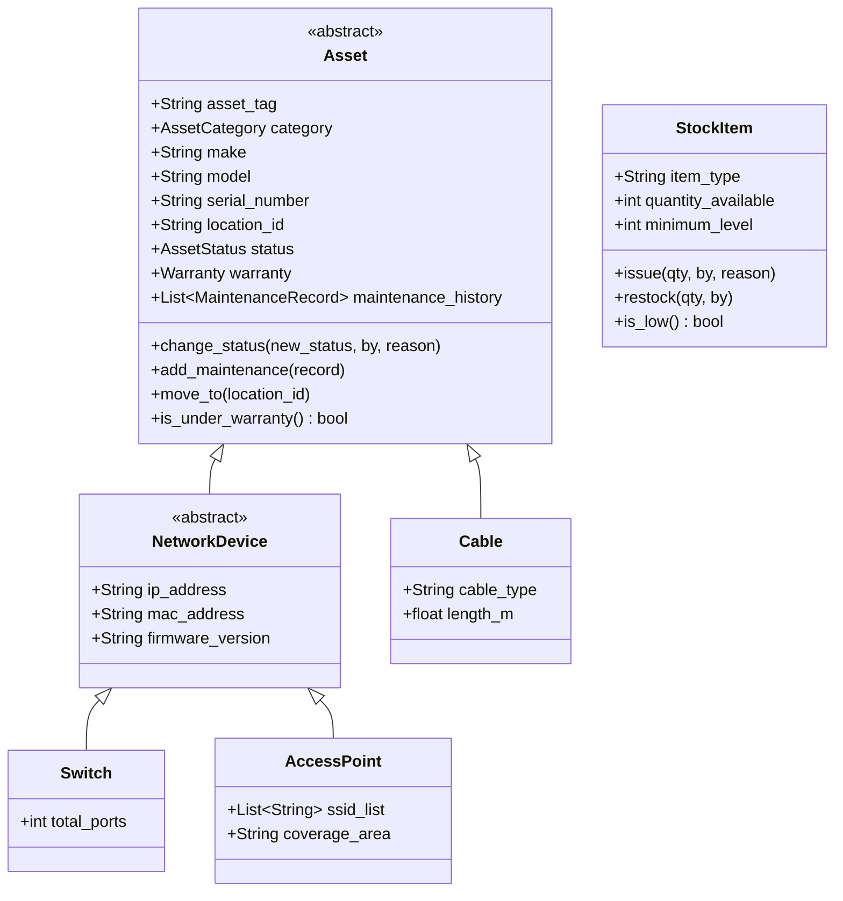

<!-- MODULE: Network Asset and Stock Management - this file belongs to the code for this module. -->
<!-- Technical documentation for the Network Asset and Stock Management module. -->

# Network Asset and Stock Management Module Guide

## 1. Module Overview
The **Network Asset and Stock Management** module is an isolated, admin-only management system integrated into the MNNIT Network Portal. It tracks physical hardware assets (switches, routers, access points, firewalls, cables, racks), campus location hierarchies, switch port serving mappings, and bulk stock inventory movements without interfering with complaints or chatbot operations.

---

## 2. Core Architectural Concepts

### 1. Difference Between Asset & Stock

In this system, dono ke liye alag collections aur domain models hain:

| Feature | Asset (`na_assets` collection) | Stock / Consumables (`na_stock_items` collection) |
| :--- | :--- | :--- |
| **Kya represent karta hai?** | High-value, durable network equipment / hardware devices. | Consumable inventory items ya spare parts jo repair mein consume ho jaate hain. |
| **Examples in code** | `SWITCH`, `ROUTER`, `ACCESS_POINT`, `FIREWALL`, `UPS`, `PATCH_PANEL`, `OPTICAL_DEVICE`. | RJ45 Connectors, Cat6 Patch Cables, SFP Modules, Keystones, Crimp plugs, Cable clips. |
| **Tracking Method** | **Individual Unique Tracking**: Har asset ka apna unique `asset_tag` (e.g. MNNIT-SW-001), `serial_number`, IP address, MAC address, aur firmware version hota hai. | **Quantity-Based Tracking**: Inka koi individual serial number nahi hota. Inhe `quantity_available` aur `minimum_level` se track kiya jata hai. |
| **Lifecycle Status** | Status transitions hote hain: `IN_USE`, `SPARE`, `FAULTY`, `UNDER_REPAIR`, `REPLACED`, `RETIRED`. | Simple quantity balance: issue (deduct quantity), restock (add quantity), and `is_low` alert jab stock minimum level se kam ho. |
| **History & Audit** | Full `maintenance_history` (repairs, cost, complaint ID) aur `status_history` maintain hoti hai. | Har stock transaction `na_stock_transactions` collection mein log hoti hai (`complaint_id`, `used_by`, `change`). |
| **Technician Workflow** | Technician repair ke waqt asset ka status change karta hai (e.g., port/device marked `FAULTY` ya `REPLACED`). | Technician resolution ke time `items_used` specify karta hai (e.g., 2 Patch Cables, 4 RJ45 connectors), jisse stock automatically deduct ho jata hai. |

#### Summary:
- **Asset**: Ek unique device jo salo tak chalti hai aur maintain/repair hoti hai (jaise Cisco Switch ya Wi-Fi AP). Consume nahi hoti.
- **Stock**: Ek consumable item jiska dabba ya bundle hota hai aur repair ke dauran use/consume ho jata hai (jaise wire ya connectors).

---

### 2. Location Tracking: Building, Room, ya Single Entity?

Location tracking do alag-alag layers par hoti hai:

#### A. Database Layer: `na_locations` (Hierarchical Parent-Child Tree)

Location single flat entity nahi hai, balki ek hierarchical tree structure hai jo `Location` aur `LocationService` mein defined hai:
- Har location document mein 4 key fields hote hain:
  1. `name`: Location ka display name (e.g., "SVBH Hostel" ya "Room 102").
  2. `code`: Unique code (e.g., "SVBH" ya "SVBH-R102").
  3. `type`: Enum `LocationType` (`HOSTEL`, `BUILDING`, `LAB`, `ROOM`).
  4. `parent_id`: Parent location ka reference `_id`.
- **Parent-Child Relation**:
  - Building/Hostel (e.g., SVBH Hostel, type: `HOSTEL`) ka `parent_id = None` hota hai (Root Node).
  - Room (e.g., Room 102, type: `ROOM`) ka `parent_id` us hostel/building ke `_id` ko point karta hai.
  - In fact, `LocationService.create_location` mein strict validation rule hai:
    ```python
    if loc_type == LocationType.ROOM and not parent_id:
        raise ValueError("Rooms must have a parent building, hostel, or lab assigned.")
    ```

#### B. Asset & Switch Port Association Layer

- **Assets (`na_assets`)**: Har asset `location_id` field ke through kisi hostel, building, lab ya specific room se linked hota hai.
- **Switch Ports (`na_switch_ports`)**: Har port ka apna `location_id` hota hai jo map karta hai ki switch port kis specific room/area ko network connectivity provide kar raha hai.
- **Breadcrumb Resolution**: `LocationService.get_location_path(loc_id)` recursively parent hierarchy traverse karke full breadcrumb generate karta hai (e.g., `SVBH Hostel > Floor 1 > Room 102`).
- **Tree Visualization**: `LocationService.list_locations_tree()` root nodes se nested children build karta hai UI display ke liye.

---

## 3. Domain Class Hierarchy (Mermaid Diagram)



---

## 4. MongoDB Collections & Indexes

| Collection Name | Key Fields | Indexes Created |
| :--- | :--- | :--- |
| `na_assets` | `asset_tag`, `category`, `make`, `model`, `serial_number`, `location_id`, `status` | `serial_number` (unique), `asset_tag` (unique), `(category, status)`, `location_id` |
| `na_locations` | `name`, `code`, `type`, `parent_id` | `code` (unique), `parent_id` |
| `na_switch_ports` | `switch_id`, `port_number`, `status`, `vlan`, `location_id` | `(switch_id, port_number)` (unique) |
| `na_stock_items` | `item_type`, `make`, `model`, `quantity_available`, `minimum_level` | `item_type` |
| `na_stock_transactions`| `stock_item_id`, `change`, `reason`, `by`, `date` | `stock_item_id` |

---

## 5. Key Business Rules
1. **Uniqueness**: `serial_number` and `asset_tag` must be globally unique across all assets.
2. **Lifecycle Transitions**: `FAULTY`, `REPLACED`, or `RETIRED` assets cannot be moved directly to `IN_USE` without passing through `SPARE` or `UNDER_REPAIR` first. Status changes require a justification reason.
3. **Non-Empty Deletion Shield**: Locations containing active assets, child sub-locations, or mapped switch ports cannot be deleted.
4. **Automatic Retirement**: Assets with recorded maintenance/repair history are automatically marked `RETIRED` rather than hard deleted.
5. **Stock Bounds**: Bulk stock quantity cannot fall below zero.

---

## 6. API Reference & Sample Payloads

Base path: `/api/admin/network-assets` (Requires `Authorization: Bearer <token>`)

### 1. `POST /assets`
Creates a concrete asset subclass depending on `category`.
```json
{
  "asset_tag": "MNNIT-SW-004",
  "category": "SWITCH",
  "make": "Cisco",
  "model": "Catalyst 9300",
  "serial_number": "SN-SW-004",
  "location_id": "660c1a2b3c4d5e6f7a8b9c0d",
  "installation_date": "2026-03-31",
  "installed_by": "MNNIT Admin",
  "status": "SPARE",
  "total_ports": 24,
  "ip_address": "172.16.1.15"
}
```

### 2. `POST /stock/{id}/issue`
Issues bulk stock out of inventory and logs transaction.
```json
{
  "quantity": 2,
  "reason": "Deployed in Hostel Block A Room 214"
}
```

### 3. `GET /reports/summary`
Returns summary metrics card totals.
```json
{
  "total_assets": 12,
  "by_category": { "SWITCH": 3, "ACCESS_POINT": 2 },
  "by_status": { "IN_USE": 8, "SPARE": 3, "FAULTY": 1 },
  "spare_total": 3,
  "faulty_total": 1,
  "under_repair_total": 0,
  "low_stock_count": 1
}
```

---

## 7. Directory Map of Added Files

- **Backend**: `backend/app/network_assets/`
  - `models.py`, `factory.py`, `schemas.py`, `repository.py`, `services.py`, `router.py`
- **Frontend**:
  - `frontend/src/api/networkAssets.ts`
  - `frontend/src/components/network-assets/NetworkAssetsNav.tsx`
  - `frontend/src/pages/admin/network-assets/`: `Overview.tsx`, `AssetList.tsx`, `AssetForm.tsx`, `AssetDetail.tsx`, `Locations.tsx`, `SwitchPorts.tsx`, `Stock.tsx`
- **Scripts & Docs**:
  - `scripts_db/create_network_assets_indexes.py`
  - `scripts_db/seed_locations_helper.py`
  - `scripts_db/seed_network_assets_demo.py`
  - `scripts_db/seed_network_assets_extended.py`
  - `docs/NETWORK_ASSETS.md`
- **Tests**: `backend/tests/test_network_assets.py`

---

## 8. Seed Data

The module provides two database seed scripts located under `scripts_db/`:

### 1. Demo Seed (`scripts_db/seed_network_assets_demo.py`)
- **Purpose**: Cleans up old placeholder locations and seeds concise demo assets, switch ports, and stock items tied to real MNNIT campus locations.
- **Execution**:
  ```bash
  PYTHONPATH=. python3 scripts_db/seed_network_assets_demo.py
  ```

### 2. Extended Seed (`scripts_db/seed_network_assets_extended.py`)
- **Purpose**: Inserts a comprehensive dataset covering all 10 asset categories (~70 assets), realistic makes and models (Cisco, Aruba, Fortinet, APC, etc.), 8+ switches with mapped ports, 16+ stock items with transactional history, active/expiring/expired warranty scenarios, and maintenance histories.
- **Marks Data**: All created asset serials, tags, and stock models are prefixed with `EXT-`.
- **Execution & Cleanup**:
  ```bash
  # Insert extended test dataset
  PYTHONPATH=. python3 scripts_db/seed_network_assets_extended.py

  # Remove ONLY extended test records (prefixed with EXT-) without touching demo or real data
  PYTHONPATH=. python3 scripts_db/seed_network_assets_extended.py --remove
  ```

---

## 9. Execution Commands
- Create Indexes: `PYTHONPATH=. python3 scripts_db/create_network_assets_indexes.py`
- Seed Demo Data: `PYTHONPATH=. python3 scripts_db/seed_network_assets_demo.py`
- Seed Extended Data: `PYTHONPATH=. python3 scripts_db/seed_network_assets_extended.py`
- Remove Extended Data: `PYTHONPATH=. python3 scripts_db/seed_network_assets_extended.py --remove`
- Run Tests: `PYTHONPATH=. pytest backend/tests/test_network_assets.py`
