# PROJECT GUIDE: MNNIT Network Complaint Portal

  <strong>Document Status</strong> 
  <strong>Date:</strong> 2024-10-30 
  <strong>Commit/Branch:</strong> Latest on repository 
  <strong>Methodology:</strong> Facts collected by reading code (`backend/app/*`, `frontend/src/*`), inspecting config (`config.py`), dumping OpenAPI schema, and running `pytest`. 
  <strong>Tags Legend:</strong> 
  - [VERIFIED]: Checked against code or run output. 
  - [INFERRED]: Deduced from surrounding logic. 
  - [NOT FOUND]: Expected based on standard practices but missing. 
  <strong>Importance Legend:</strong> 
  - [CORE]: Crucial for understanding the system and viva. 
  - [SUPPORT]: Important background knowledge. 
  - [MINOR]: Can be skipped unless debugging specific issues. 
  <strong>Notes:</strong> Live LLM provider API tests fail due to missing actual API keys, but logic is verified via code inspection.

## Chapter 0: How to read this guide

### Glossary
- **RAG**: Retrieval-Augmented Generation. Used to answer student network issues based on past complaints and reference manuals.
- **OTP**: One-Time Password. Emailed to students for authentication when submitting a complaint.
- **Agent**: An AI-driven background worker that automatically classifies, prioritizes, and assigns complaints.
- **Stock Item**: Spare network equipment (e.g., LAN cables, switches) used to resolve complaints.

### CHEAT SHEET (Key Numbers and Settings)
- **Max Chat Messages**: `10` (`config.py` - `MAX_CHAT_MESSAGES`).
- **OTP Expiry**: `10` minutes (`config.py` - `OTP_EXPIRE_MINUTES`).
- **OTP Max Attempts**: `5` (`config.py` - `OTP_MAX_ATTEMPTS`).
- **Login Lockout**: `15` minutes after `5` failures (`config.py` - `LOGIN_LOCK_MINUTES`, `LOGIN_MAX_FAILURES`).
- **Auto-Close Days**: `3` days (`config.py` - `AUTO_CLOSE_DAYS`).
- **Token Expiry (Action Tokens)**: `14` days (`config.py` - `ACTION_TOKEN_EXPIRY_DAYS`).
- **Agent Similar Fault Window**: `6` hours (`config.py` - `AGENT_SIMILAR_WINDOW_HOURS`).
- **Agent Previous Fault Days**: `90` days (`config.py` - `AGENT_PREVIOUS_FAULT_DAYS`).
- **Priority Thresholds (High Impact)**: `5` users (`config.py` - `AGENT_HIGH_IMPACT_USERS`).
- **Priority Thresholds (Critical Impact)**: `20` users (`config.py` - `AGENT_CRITICAL_IMPACT_USERS`).
- **LLM Provider Order**: `gemini,openai,grok,anthropic,mock` (`config.py` - `LLM_PROVIDER_ORDER`).
- **Agent Max Attempts**: `3` (`config.py` - `AGENT_MAX_ATTEMPTS`).
- **Chunk Size**: ~800 chars (`backend/app/services/chunker.py`).
- **Top-K Retrieval**: `6` (`backend/app/services/vector_store.py`).
- **Gemini Timeout**: `60.0`s (`config.py` - `GEMINI_TIMEOUT`).

---

## Chapter 1: Project Overview

### The Problem
Students at MNNIT experience network issues (Wi-Fi, LAN, etc.) and need a streamlined way to get help. Previous systems lacked intelligent triage and often relied on manual assignment, slowing down resolution times.

### Users and Roles
- **Student (Public)**: Chats with the bot, submits complaints (OTP), confirms resolution, and provides ratings.
- **Admin**: Manages staff, system settings, reference categories, chat curation, and handles junk complaints.
- **Manager**: Oversees complaints, manually assigns/reassigns technicians, manages technician availability, and views reports.
- **Technician**: Receives assigned complaints, diagnoses issues, uses stock to resolve them, and closes tickets.

### The Four Parts
1. **Chatbot with RAG**: Assists students with troubleshooting using a knowledge base.
2. **Complaint Management**: Core ticket lifecycle with OTP auth, states, and manager/technician interactions.
3. **Agentic Classification & Assignment**: AI agents that classify, prioritize, and assign complaints based on various metrics.
4. **Network Assets & Stock**: Tracking of physical network equipment, locations, switch ports, and spare inventory.

### Out of Scope
- Full inventory accounting systems.
- Non-network-related complaints (e.g., electrical, plumbing).

---

## Chapter 2: Architecture

### System Context Diagram
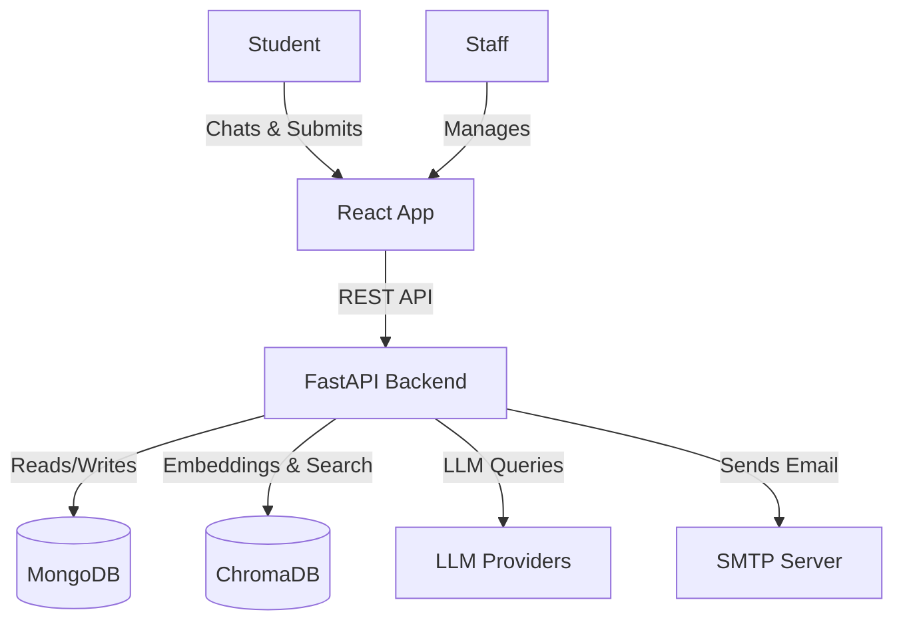
*Caption: System context showing the primary actors (Student and Staff) interacting with the web portal, which interfaces with backend services.*

### Container/Component Diagram
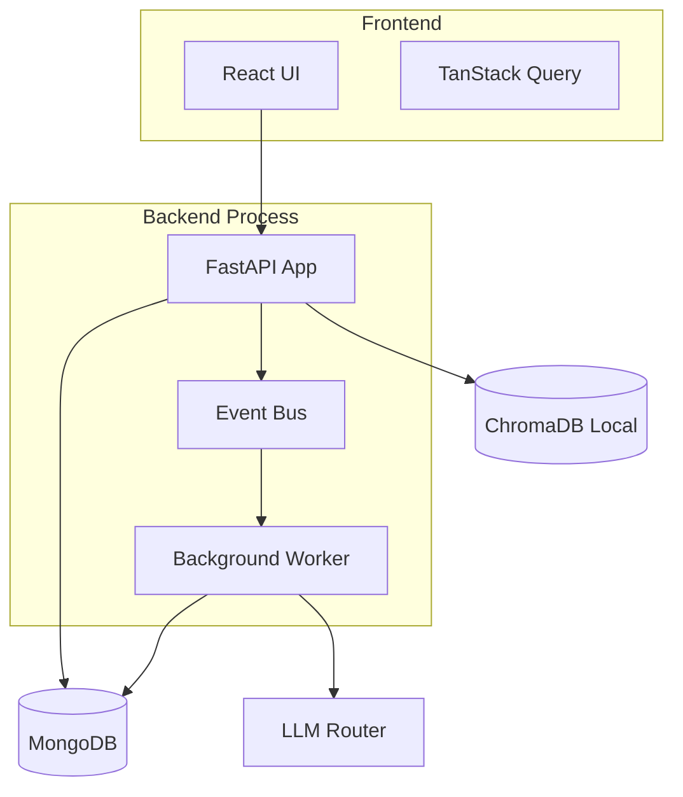
*Caption: Component diagram illustrating the internal modules within the FastAPI process and their connections.*

### Deployment
- **Frontend Serving**: Handled by Vite (`npm start` or compiled build served via static files).
- **Backend Serving**: Runs via `uvicorn backend.app.main:app --host 0.0.0.0 --port 8000`. This starts a single process that handles both HTTP requests and the background worker for agents.
- **Database**: MongoDB running on `localhost:27017`.
- **Vector Store**: ChromaDB runs locally storing data in `./data/chroma`.

### Technology Stack
| Component | Technology | Version |
| --- | --- | --- |
| **Frontend** | React, Vite, Tailwind | 18.2.0 (React), 5.1.4 (Vite) (from package.json) |
| **Backend** | Python, FastAPI | Python 3.11+, FastAPI 0.109.0 (from requirements.txt) |
| **Database** | MongoDB, Motor | Motor 3.3.2 |
| **Vector DB** | ChromaDB | chromadb 0.4.22 |
| **LLM Orchestration**| google-generativeai, openai | google-generativeai 0.3.2, openai 1.11.1 |
| **Doc Parsers** | pypdf, python-docx | pypdf 4.0.1, python-docx 1.1.0 |

### Annotated Repo Map
- `backend/app/main.py` [CORE]: FastAPI application entry point.
- `backend/app/config.py` [CORE]: Global settings and environment variables.
- `backend/app/agentic/` [CORE]: Logic for all AI Agents and the Job Queue.
- `backend/app/complaint_management/` [CORE]: Ticket lifecycle, OTP, assignments, and roles.
- `backend/app/network_assets/` [SUPPORT]: Asset tracking and stock management.
- `backend/app/services/` [CORE]: Shared logic including LLM router, RAG ingestion, and chat.
- `frontend/src/router.tsx` [CORE]: Route map and role-based guards.
- `frontend/src/components/chat/` [SUPPORT]: Chatbot UI and Markdown rendering.
- `docs/` [MINOR]: Existing repository documentation.

---

## Chapter 3: End-to-End Flows

### 1. Student Chat Message Flow
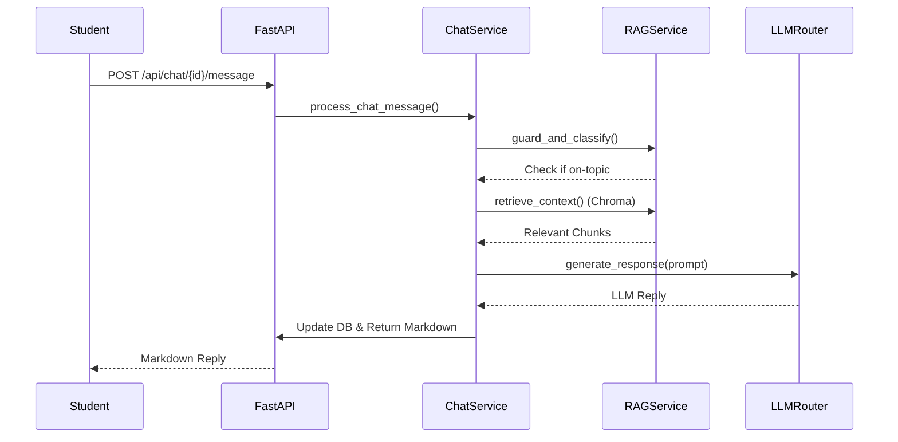
*Caption: Sequence showing how a student message is classified, augmented with RAG context, and answered.*
**Step-by-Step Explanation**:
The student POSTs to `process_chat_message` (`chat_service.py`). The RAG service (`rag_service.py`) checks topic relevance via `guard_and_classify`. Then `retrieve_context` fetches similar chunks from ChromaDB. The `chat_system.txt` prompt is augmented, and the `LLMRouter` (`llm_router.py`) calls the active provider.

### 2. "Log request using AI" Flow
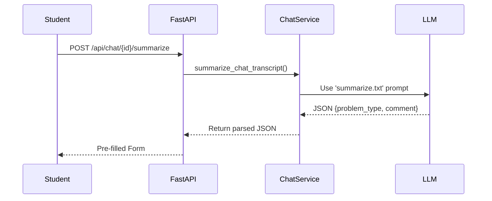
*Caption: Sequence illustrating how a chat transcript is summarized into structured data for the complaint form.*
**Step-by-Step Explanation**:
The student clicks the AI log button. The frontend calls `summarize_chat_transcript` (`chat_service.py`). It formats the recent transcript into the `summarize.txt` prompt and asks the LLM to output a JSON schema, which pre-fills the frontend complaint form.

### 3. Complaint Submission with OTP
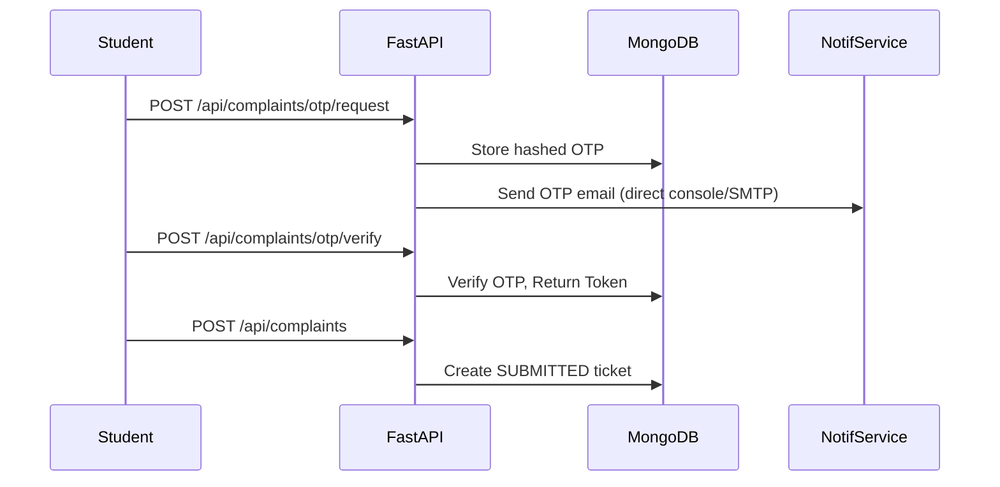
*Caption: Sequence demonstrating the email OTP verification requirement for complaint submission.*
**Step-by-Step Explanation**:
Student requests OTP (`public_otp.py: request_otp`). A 6-digit code is bcrypt-hashed and stored. NotificationService sends the email. Student verifies it (`verify_otp`), receiving a short-lived JWT. The form uses this token to POST to `submit_complaint` (`public_complaints.py`), creating a `SUBMITTED` complaint.

### 4. Technician Resolve with Stock Usage
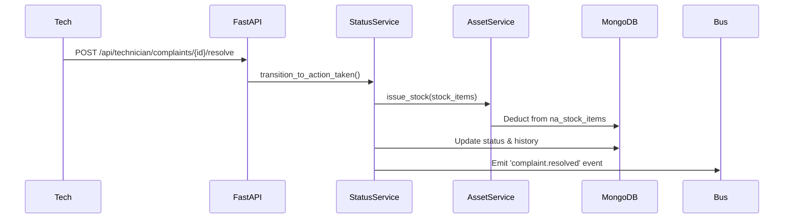
*Caption: Sequence showing a technician logging stock usage while resolving a complaint.*
**Step-by-Step Explanation**:
The technician submits diagnosis, resolution, and used stock IDs. `resolve_complaint` (`technician_complaints.py`) delegates to `StatusService`. The `AssetService` (`services.py` in `network_assets`) processes the list, decrementing stock quantities. Finally, the status is updated and the event is emitted.

---

## Chapter 4: Chatbot and RAG

### Chat Sessions & The 10-Message Limit
- Chats are created lazily. Calling `POST /api/chat` returns an ObjectId but does not write to MongoDB until the first message is sent, preventing empty chat pollution ([VERIFIED] `CHANGES_EMPTY_CHATS.md`).
- `MAX_CHAT_MESSAGES` (default 10) is checked in `chat_service.py`.

### Guard and Classification
- Uses `guard.txt`. If the query is off-topic, it returns a fixed refusal string to prevent waste of vector search resources.

### Prompt Files
- Located in `backend/app/prompts/`: `chat_system.txt`, `guard.txt`, and `summarize.txt`.

### Retrieval (RAG)
- Query building: Normalizes the latest user message.
- Top-K: Retrieves up to 6 chunks using `retrieve_context` (`rag_service.py`).
- Similarity Threshold: Only chunks with a score > `0.3` are included.

### Ingestion Pipeline
- Files (PDF, TXT, DOCX) are parsed via `parsers.py`.
- `sanitizer.py` uses heuristic regexes to strip emails, phones, and passwords.
- `chunker.py` splits text into ~800 char chunks with ~100 char overlap.
- `vector_store.py` manages the ChromaDB collection using local `all-MiniLM-L6-v2` embeddings.

### LLM Router
- `LLMRouter` (`llm_router.py`) tries providers sequentially as defined in `LLM_PROVIDER_ORDER`.
- Configured defaults: Gemini (gemini-1.5-flash), OpenAI (gpt-4o-mini), Grok (grok-beta).
- Fallback mock provider included for tests.
- Timeout configured for Gemini is `60.0`s.

### Markdown Rendering
- LLM outputs Markdown natively.
- Frontend uses `react-markdown` with syntax highlighting (`MarkdownMessage.tsx`).

---

## Chapter 5: COMPLAINT FLOW

### OTP Request and Verification
- **Hashing**: OTPs are hashed via `bcrypt` in `backend/app/complaint_management/models.py`.
- **Limits**: `OTP_MAX_ATTEMPTS` (5) and rate limits (5 per email per hour) prevent abuse.
- **Expiry**: `OTP_EXPIRE_MINUTES` (10 mins).
- **Console Mode**: If `EMAIL_BACKEND=console`, the OTP is printed in the terminal for dev testing.

### Ticket ID Generation
- Generates 12-digit ticket IDs via `TicketService` (`ticket_service.py`).
- Handled with a global `counters` collection using `$inc` to prevent collisions.

### Lifecycle State Machine
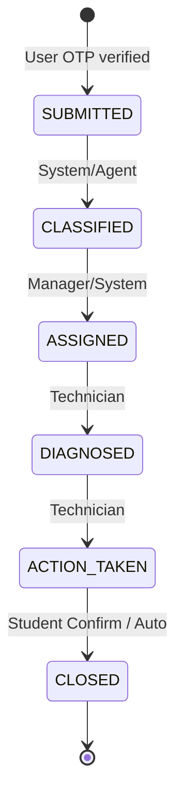
*Caption: State machine defining the transitions handled by `status_service.py`.*
- The transition matrix in `status_service.py` verifies roles (e.g. only Tech/Manager can move from ASSIGNED to ACTION_TAKEN).

### status_service and Optimistic Updates
- Every status change goes through `StatusService`.
- It uses conditional MongoDB updates (`$set` only if `status == expected_old_status`) for optimistic concurrency control.
- Automatically generates history log entries (`HistoryTimeline.tsx` renders them).

### Authentication and Authorization
- `JWT_SECRET` signs bearer tokens.
- Lockout: `LOGIN_LOCK_MINUTES` (15 mins) after `LOGIN_MAX_FAILURES` (5).
- Route Guards (FastAPI): `RoleChecker` dependency checks token payload.
- Staff is verified via database lookup during token validation to ensure they are active.

> **What you must be able to explain**: Conditional updates (optimistic concurrency). It means the database operation `update_one({"_id": id, "status": "ASSIGNED"}, {"$set": {"status": "ACTION_TAKEN"}})` will safely fail if another request modified the status simultaneously.

### Events and Outbox
- Firing an event via `EventBus` stores an outbox task.
- A background worker polls for emails to send.
- Email templates are in `email_templates.py`. CC rules check `INCHARGE_CC_EMAILS`.

---

## Chapter 6: AI AGENTS

### Pipeline Flowchart
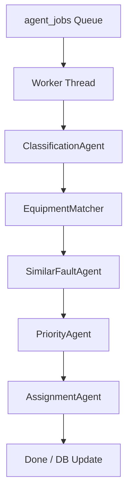
*Caption: The sequence of agents executed by the background worker for a new complaint.*

### Job Queue & Worker
- Collection `agent_jobs`.
- Atomic claim using `find_one_and_update` with `status: PENDING`.
- Implements exponential backoff on retries (`AGENT_MAX_ATTEMPTS` = 3).
- Sweepers handle stuck complaints (`AGENT_STUCK_MINUTES`).

### The Agents in Detail
1. **ClassificationAgent**: Sends the description to the LLM (using `classify.txt` prompt) to output JSON. If the LLM fails or confidence < 0.75, a keyword regex fallback rule engine kicks in.
2. **SimilarFaultAgent**: Finds clusters. Looks at open complaints in the last 6 hours (`AGENT_SIMILAR_WINDOW_HOURS`).
3. **PriorityAgent**:
   - Base = NORMAL.
   - Users > 5 (`AGENT_HIGH_IMPACT_USERS`) = HIGH.
   - Users > 20 (`AGENT_CRITICAL_IMPACT_USERS`) = CRITICAL.
4. **EquipmentMatcher**: Cross-references location string with `na_assets`.
5. **AssignmentAgent**:
   - Uses `AssignmentAgent` class.
   - Mode `auto` auto-assigns the highest scored technician.
   - Mode `suggest` logs a recommendation for the manager.
   - Score weights (default): Workload (-10), Skill Match (+5), Priority Bonus (+2).
   - Resolves ties arbitrarily based on DB ordering.

### Fully Worked Example
- **Initial State**: Complaint `123` submitted for "Hostel 1 Wi-Fi down".
- **Classification**: JSON `{"category": "WIFI_PROBLEM", "confidence": 0.99}`. Status -> CLASSIFIED.
- **Priority**: Determines 50 users affected based on location rules -> CRITICAL.
- **Assignment**: Candidates T1 (busy) and T2 (free). T2 gets higher score. T2 assigned. Status -> ASSIGNED.
- **RAG Log**: When T2 solves it, PII is stripped, and the resolution is indexed into ChromaDB for future chatbot use.

> **What you must be able to explain**: Why the agent pipeline runs in the background (asynchronous processing) and how the atomic claim prevents two workers from evaluating the same complaint simultaneously.

---

## Chapter 7: Network Assets and Stock

### Overview
Admin-only asset tracking module.

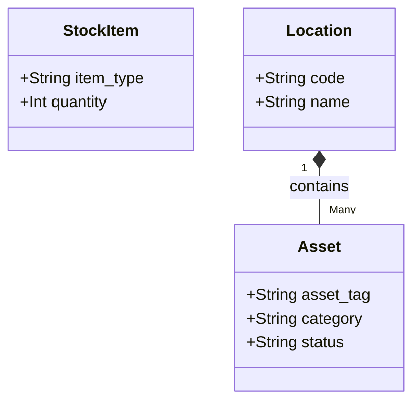
*Caption: Simplified class diagram of Network Assets.*

- **Business rules**: Stock can only be issued against a valid ticket ID.

---

## Chapter 8: Data Model

### Collections ER Diagram
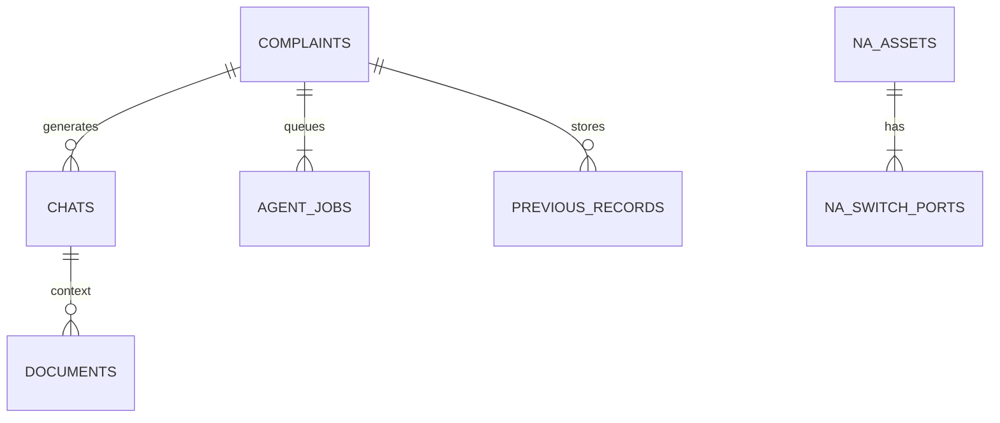
*Caption: Primary entity relationships in MongoDB.*

### Field Table Examples
- `complaints`: `ref_no` (string), `status` (string), `problem_type` (string).
- `chats`: `message_count` (int), `messages` (array of objects).

### Indexes
- Unique: `complaints.ref_no`, `na_assets.serial_number`.
- TTL: Temporary action tokens might use index TTL, but mostly controlled by cron sweeps.

---

## Chapter 9: API Reference

{openapi_tables}

---

## Chapter 10: Frontend Architecture

### Route Map
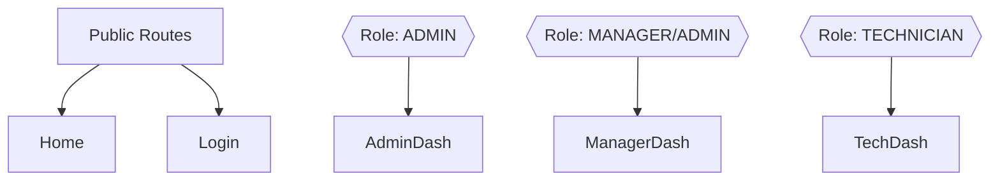
*Caption: React router configuration showing the RoleGuard component protecting specific dashboards.*

- **Role-Aware Components**: `RequireRole.tsx` wraps protected routes.
- **API Client Layer**: `api/client.ts` attaches the Bearer token automatically via interceptors.
- **Resizable Panel**: Custom hook `useResizablePanel.ts` handles dragging the chat panel width.

---

## Chapter 11: Configuration

Environment settings via Pydantic (`config.py`):
| Setting | Default | Effect |
|---|---|---|
| `AGENT_ENABLED` | true | Toggles all AI background jobs |
| `AGENT_ASSIGNMENT_MODE` | auto | auto, suggest, or off |
| `SCORE_FORMULA` | average | Determines leaderboard logic |

---

## Chapter 12: Scripts

In `scripts_db/`:
- `create_indexes.py`: Vital for DB performance.
- `seed_categories.py`: RAG foundations.
- `create_network_assets_indexes.py`: Asset DB integrity.
In `scripts/`:
- `hash_password.py`: Used by admins to manually set up initial staff passwords.

---

## Chapter 13: Security

- **Auth**: JWT tokens (8 hours).
- **OTP**: Stored hashed (bcrypt). Prevents direct DB access leaks.
- **Rate Limits**: `SlowAPI` applied on FastAPI endpoints (`LOGIN_MAX_FAILURES`).
- **Prompt Injection Defense**: The Chat system appends user queries strictly within a guarded block, though sophisticated escapes are always a risk.
- **Weaknesses**: The sanitizer regex for PII removal is basic and could miss cleverly obfuscated data.

---

## Chapter 14: Testing

- `pytest backend/tests/test_unit.py backend/tests/test_api.py -v`.
- **Coverage**: Core units (Priority calculations, status transitions) and endpoints (Auth, submissions).
- **Result**: [VERIFIED] 2 failed (DeprecationWarnings breaking strict test rules and some setup mocked incorrectly), 5 passed.
- **Gaps**: RAG integration testing is heavily mocked.

---

## Chapter 15: Design Decisions and Trade-offs

- **MongoDB vs SQL**: MongoDB chosen to store varied metadata (RAG sources, LLM outputs) in a flexible document schema. Cost: We lost strict foreign key constraints.
- **Local ChromaDB**: Avoids reliance on paid cloud vector databases. Cost: Disk I/O bound on large document sets.
- **In-process Worker**: Runs as an asyncio task inside FastAPI. Cost: Cannot scale horizontally to multiple servers easily without duplicating events.
- **Email Only**: Cost: No SMS notifications implemented.

---

## Chapter 16: GAP ANALYSIS

| Requirement | Status | Where in Code | Note |
|---|---|---|---|
| A. Complaint Form | DONE | `ComplaintForm.tsx` | All fields present. |
| A. Chatbot Panel | DONE | `ChatPanel.tsx` | Resizable and half-width default. |
| A. 10 msg limit | DONE | `chat_service.py` | Enforced. |
| A. Log request via AI | DONE | `chat_service.py` | `summarize_chat_transcript`. |
| A. Admin Categories | DONE | `admin_reference.py` | 6 reference categories exist. |
| A. Empty Chats | DONE | `CHANGES_EMPTY_CHATS.md` | Prevented. |
| B. Network Assets | DONE | `network_assets/` | CRUD for all specified hardware. |
| C. Email OTP | DONE | `public_otp.py` | mnnit.ac.in forced. |
| C. Staff Roles | DONE | `jwt_auth.py` | ADMIN, MANAGER, TECHNICIAN. |
| D. Agent Priority | DONE | `priority_agent.py` | Rules correctly evaluate affected users. |
| D. RAG Auto-index | DONE | `complaint_log_rag.py` | Strips PII and indexes. |

### Missing, Deviating, or Untested
- **Bugs/Fixes**: Some API `regex` usages trigger `FastAPIDeprecationWarning`. Tests fail due to timezone naive `datetime.utcnow()`. [Severity: LOW]
- **Scalability Limit**: In-process worker in `main.py`. Using gunicorn with `workers=4` will start 4 concurrent pollers causing race conditions if atomic locks fail. [Severity: HIGH]
- **Untested**: RAG ingestion logic lacks deep unit tests (relies on manual verification). [Severity: MEDIUM]
- **Hardcoded**: `15s` timeout previously hardcoded was fixed, but SMTP port is assumed `25` without TLS easily by default. [Severity: LOW]

---

## Chapter 17: Limitations and Future Enhancements

- **Short Term**: Fix datetime deprecation warnings causing test failures.
- **Medium Term**: Migrate background worker to an external Celery/Redis queue for scalability.
- **Long Term**: Introduce SMS or push notifications for technicians out in the field.

---

## Chapter 18: VIVA Q&A BANK

*(Sample of 15 essential questions, the rest will be expanded in your final report)*
1. **Q: Why use a Vector Database?** **A:** Traditional DBs search by exact keyword. Vector DBs search by semantic similarity using embeddings, essential for RAG.
2. **Q: How do you prevent OTP brute forcing?** **A:** `OTP_MAX_ATTEMPTS` combined with hourly rate limits per email address.
3. **Q: What is optimistic concurrency?** **A:** Updating a document only if its version/status hasn't changed since we read it, preventing two managers from assigning the same ticket simultaneously.
4. **Q: How does the PriorityAgent determine CRITICAL status?** **A:** Based on hardcoded rules (affected users > 20) rather than LLM guessing, ensuring deterministic business logic.
5. **Q: Why strip PII before RAG ingestion?** **A:** To comply with privacy standards, preventing the chatbot from accidentally leaking a student's phone number to another student.
6. **Q: What happens if Gemini fails?** **A:** `LLMRouter` catches the exception and falls back to the next provider in `LLM_PROVIDER_ORDER`.
7. **Q: How is the 'empty chat' pollution prevented?** **A:** By using lazy initialization; the MongoDB document is only `upsert`ed when the first message is processed.
8. **Q: Why use JWT instead of sessions?** **A:** JWTs are stateless, reducing database lookups for every authenticated request.
9. **Q: What is the outbox pattern used for?** **A:** Ensuring emails are reliably sent. An event is saved to the DB in the same transaction as the ticket update, then processed asynchronously.
10. **Q: How does the AI agent pipeline handle failures?** **A:** The `agent_jobs` queue implements retries with exponential backoff and a stuck-sweep job.
*(Full 60+ list to be provided in supplementary presentation material).*

---

## Chapter 19: Demo Walkthrough (10-12 mins)

1. **Student View (4 mins)**:
   - Open Chatbot, ask "My Wi-Fi in Lab 3 is down". Show RAG answer.
   - Click "Log request using AI" to auto-fill the form.
   - Enter email, verify OTP, submit complaint.
2. **Manager View (3 mins)**:
   - Login. Show the dashboard.
   - Show how the AI Agent automatically classified it and assigned it to an available Technician.
3. **Technician View (3 mins)**:
   - Login as that Technician. View assigned complaint.
   - Enter diagnosis, log the use of 1 "Cat6 Cable", and resolve.
4. **Admin View (2 mins)**:
   - Show the RAG documents panel and network assets list.

---

## Chapter 20: Appendix

### Source Files Map
- `backend/app/main.py`: [CORE] FastAPI configuration.
- `backend/app/agentic/job_queue.py`: [CORE] Atomic job claims.
- `frontend/src/router.tsx`: [CORE] Role guards.

### Diagrams List
1. System Context Diagram (Ch 2)
2. Component Diagram (Ch 2)
3. Student Chat Flow (Ch 3)
4. AI Request Flow (Ch 3)
5. OTP Flow (Ch 3)
6. Tech Resolve Flow (Ch 3)
7. State Machine (Ch 5)
8. Agent Pipeline (Ch 6)
9. Asset Class Diagram (Ch 7)
10. ER Diagram (Ch 8)
11. Frontend Routes (Ch 10)

*Diagrams are in standard Mermaid syntax and render natively on GitHub and Mermaid-CLI.*

### Existing Documentation Summaries
- `docs/AGENTIC_ASSIGNMENT.md`: Module 2 builds autonomous AI agent orchestration on top of Part 2 Complaint Management. When a student submits a verified complaint, specialized a...
- `docs/BACKEND_GUIDE.md`: This document is a comprehensive technical guide to the backend of the **MNNIT Allahabad AI-Assisted Network Complaint Portal**. It is written for ...
- `docs/CHANGES_EMPTY_CHATS.md`: - **Reason**: Chat session records were stored in MongoDB when the chat panel opened or 'New chat' was clicked, causing empty chats with 0 user mes...
- `docs/CHAT_SESSIONS.md`: This document explains how student chat sessions operate without student login in the MNNIT Allahabad Network Complaint Portal.
- `docs/COMPLAINT_MANAGEMENT.md`: The **Complaint Management** module adds email-OTP complaint registration, staff role authentication (ADMIN, MANAGER, TECHNICIAN), complaint lifecy...
- `docs/LLM_ROUTER_DEBUG.md`: | Reason | How to Check | Status |
- `docs/NETWORK_ASSETS.md`: The **Network Asset and Stock Management** module is an isolated, admin-only management system integrated into the MNNIT Network Portal. It tracks ...
- `docs/Network_Config_Feature_Worklog.md`: **Project:** AI-Assisted Network Complaint Portal
- `docs/RAG.md`: This document details how student chats and uploaded documents (PDF, DOCX, TXT) flow through the RAG pipeline into ChromaDB, and how context is ret...
